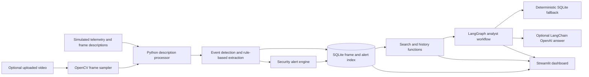

# Architecture

`simulation.py` produces deterministic frame descriptions and telemetry. `processing.py` extracts known entities and activity from text; it is deliberately not a vision model. `database.py` owns SQLite schema, transactions, and query methods. `alerts.py` evaluates stored frame records. `agent.py` creates database-backed tool functions and a LangGraph retrieval/respond workflow. With no key, `SecurityAnalystAgent` answers directly from SQLite. With a configured key, LangGraph retrieves a deterministic, record-derived context before asking the optional model to phrase it. `app.py` presents the Streamlit interface. Optional `video.py` uses OpenCV to sample and save JPEG frames, but does not infer visual content.

SQLite is the source of truth for historical frame and alert information. The demo loader deliberately resets data for repeatable demonstrations.
